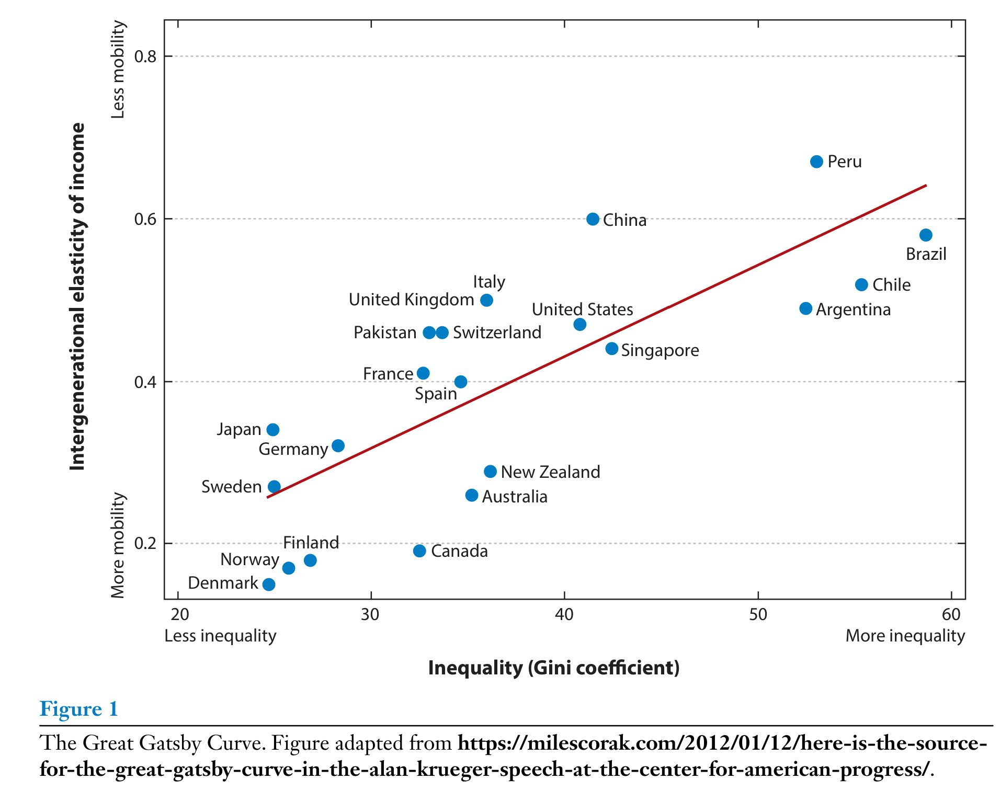
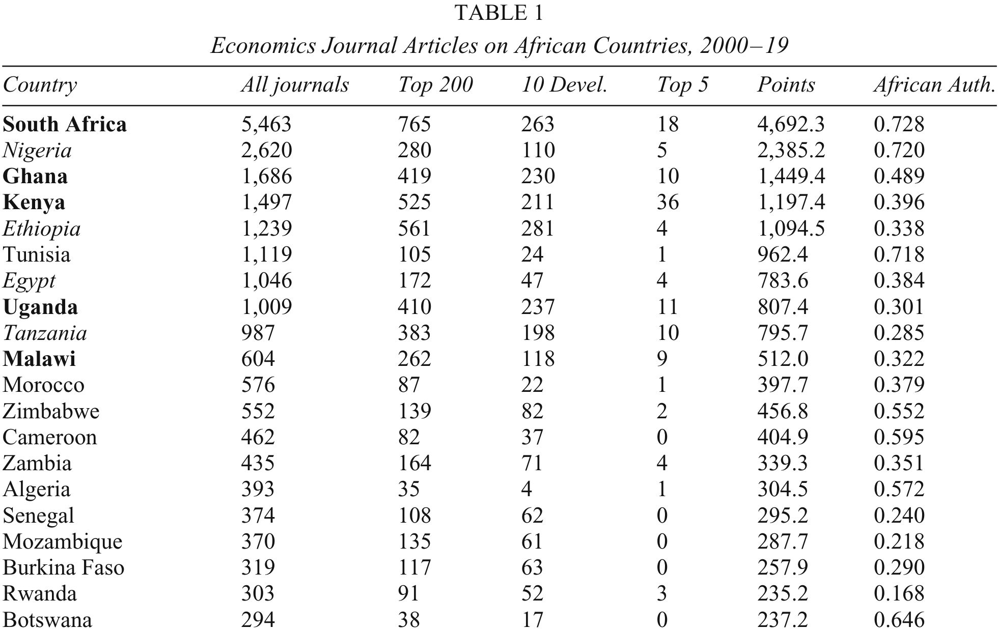
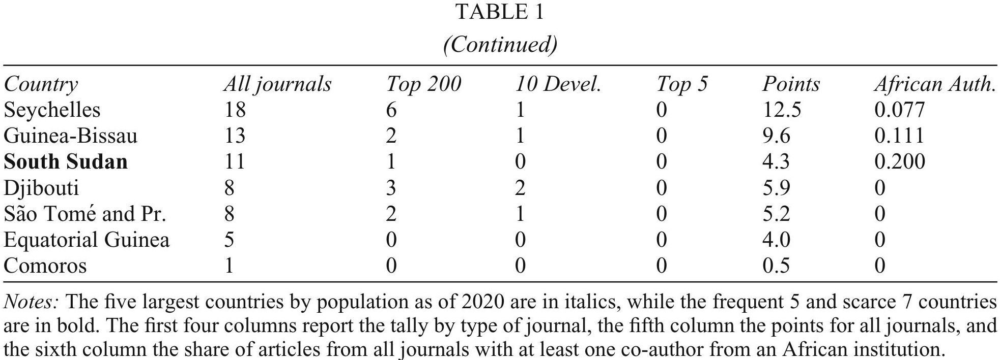

```{css}
.math.inline .MathJax  {
  font-size: 80% !important;
}
.mermaid-render svg {
    width: 70%; 
}
gray {
  color: #aeb6bf;
}
Red {
  color: Red;
}
Blue {
  color: Blue;
}
RoyalBlue
{
  color: #4169e1;
}
```

::: {style="text-align: center;"}
# はじめに
:::

----

図の表示

{width="50%"}

出所: [このページ](https://www.annualreviews.org/content/journals/10.1146/annurev-economics-082321-122703)にpdfがあります

---

リスト

. . .

長所

* 歪みなく効果を計測できる(<Red>internal validity</Red>)
   a) (結果に疑問を挟む余地は少ないので無駄な議論を節約できる)
   a) 被験者をランダムに治療群the treatedと統御群the cotrolに割り振り、前者にのみ介入
   a) Randomisation of treatment: 治療群と統御群は相似、異なるのは介入の有無だけ
   a) 結果指標の違いは介入が原因と解釈可能
* それ以外にない

. . .

::: {.nonincremental}
* 一気に
* 表示させる
:::

---

:::::: {.columns}

:::: {.column width="60%"}
{.lightbox width="50%"}  
:::: 
:::: {.column width="30%"}
:::{style="font-size: 55%;line-height: 1.1;"}
出所: <https://diabetes.diabetesjournals.org/content/64/4/1105>
:::
:::: 
::::::

ATT
: Average treatment effects on the treated: 実施群における平均効果

. . .

$$
ATT = E[y_{1i}|D_{i}=1]-E[y_{0i}|D_{i}=1].
$$


----

2列表示

::::::::::: {.columns}
:::: {.column width="40%"}
{width="100%"}

{width="100%"}

@Porteous2022, Table 1
::::

:::: {.column width="60%"}
* 人口が多い英語公用語国がトップ
* 自国で学術雑誌を持っていると上位(e.g., South African Journal of Economics)

:::{.fragment}
アフリカの経済研究で得られた知識=こうした地域からの知識
:::

:::{.fragment}
知識の出自が偏っていることを知るべき
:::

1. 西アフリカでも同じ結果?
1. アフリカ中央部でも同じ結果?

:::{.fragment}
自国での研究がないと、効果が異なる(かもしれない)のに政策が実施されてしまうかも、という意味で不利
:::
::::

:::::::::::

## {background-color="black"}

::: {style="color: white; font-size: 130%;"}
* 文字が大きい
* 色を弱めずに反転
:::

----

#### References

::: {#refs}
:::
