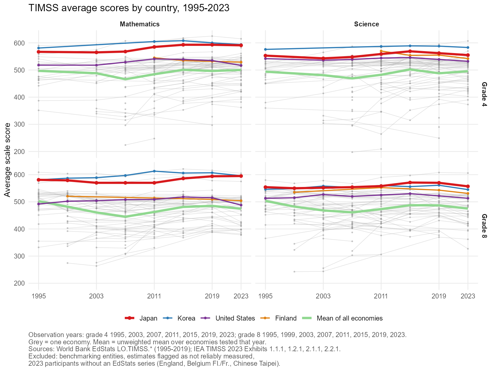
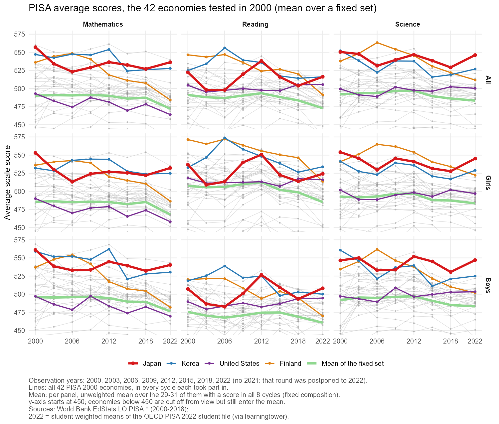

```{r}
#| label: setup
#| output: false
library(data.table)
library(tinytable)
timss <- fread("timss_scores.csv")                       # made by timss_pisa_plot.R
pisa  <- fread("pisa_scores.csv")
```

```{r}
#| label: build
#| eval: false
# Not run at render (kept as a record).
# Rebuilds timss_scores.csv, pisa_scores.csv, timss_trends.png, pisa_trends.png
# from the saved World Bank json and IEA xlsx files (no download).
source("timss_pisa_plot.R")
```

# Introduction

* This page plots country trends in two international student assessments:
  * TIMSS, 1995-2023, by grade (4, 8) and subject (mathematics, science).
  * PISA, 2000-2022, by sex and subject (mathematics, reading, science).
* Japan, Korea, the United States and Finland are highlighted against all other
  participants, with the mean of all economies in light green.
* Scores are read from saved files (World Bank EdStats, IEA TIMSS 2023, the
  PISA 2022 student file); nothing is downloaded at render.
* Sections: Data (sources, exclusions, coverage), TIMSS, PISA (all participants;
  a fixed set of economies), Reading the figures.

# Data

* TIMSS (Trends in International Mathematics and Science Study, IEA) tests
  grade 4 and grade 8 students in mathematics and science, every 4 years.
* PISA (Programme for International Student Assessment, OECD) tests
  15-year-olds in mathematics, reading and science, every 3 years.
  It has no grade dimension, so its rows are sex instead.
* Sources
  * World Bank EdStats API, source 12: `LO.TIMSS.MAT4/MAT8/SCI4/SCI8`
    (1995-2019) and `LO.PISA.MAT/REA/SCI` with `.FE`/`.MA` sex splits (2000-2018).
  * IEA TIMSS 2023 International Results, Exhibits 1.1.1 / 1.2.1 (mathematics,
    grade 4 / 8) and 2.1.1 / 2.2.1 (science, grade 4 / 8), xlsx from
    <https://timss2023.org/> Download Center.
  * PISA 2022 (not in EdStats; OECD table pages refuse automated download, 403):
    student-weighted (`stu_wgt`) means by country and sex from the full OECD
    PISA 2022 student file as redistributed by the `learningtower` project
    (`student_2022.rds`, <https://github.com/kevinwang09/learningtower>).
    * Check: the same computation on `student_2018.rds` reproduces the World Bank
      2018 values within 0.5 (all) / 0.7 (by sex) points on average, max 4.1
      points (@tbl-validate).
    * These are point estimates only; no standard errors (OECD's replicate-weight
      method is not applied).
* Exclusions
  * World Bank regional and income aggregates.
  * TIMSS 2023 benchmarking entities (e.g. Dubai, Quebec).
  * TIMSS 2023 estimates flagged "not reliably measured" (South Africa grade 4
    science, Cote d'Ivoire grade 8).
  * TIMSS 2023 participants with no EdStats series 1995-2019 (England, Belgium
    Flemish / French, Chinese Taipei).
* PISA keeps every participant in the data, including the 2022-only entries
  outside the World Bank economy list: Chinese Taipei (TAP), Baku (QAZ),
  Ukrainian regions (QUR). Kosovo's OECD code KSV is mapped to XKX.

```{r}
#| label: tbl-coverage
#| tbl-cap: "Coverage: number of economies and country-year scores per panel"
cov_t <- timss[, .(Economies = uniqueN(iso3), Scores = .N,
                   Years = paste(sort(unique(year)), collapse = ", ")),
               by = .(Row = grade, Subject = subject)]
cov_p <- pisa[, .(Economies = uniqueN(iso3), Scores = .N,
                  Years = paste(sort(unique(year)), collapse = ", ")),
              by = .(Row = as.character(sex), Subject = subject)]
cov_t[, Study := "TIMSS"]
cov_p[, Study := "PISA"]
cov <- rbind(cov_t[order(Row, Subject)], cov_p)
setcolorder(cov, "Study")
tt(cov, width = 0.9)
```

```{r}
#| label: tbl-validate
#| tbl-cap: "PISA 2018: learningtower weighted means minus World Bank values (score points)"
v <- readRDS("pisa2018_validation.rds")
v <- v[, .(Pairs = .N,
           `Mean abs. diff.` = round(mean(abs(diff)), 2),
           `Max abs. diff.` = round(max(abs(diff)), 2),
           `Share within 3 pts` = round(mean(abs(diff) <= 3), 3)),
       by = .(Sex = sex)]
tt(v, width = 0.6)
```

# TIMSS

```{r}
#| label: fig-timss
#| fig-cap: "TIMSS average scale score by country; Japan, Korea, United States, Finland highlighted; light green = mean of all economies; rows = grade, columns = subject. Click to enlarge."

```

# PISA

## All participating economies

* Lines: every PISA participant in the data, in every cycle it took part in
  (92 World Bank economies plus Chinese Taipei, Baku and Ukrainian regions in 2022).
* Mean (light green): unweighted mean over the economies tested in that year,
  so its composition changes across cycles.

```{r}
#| label: fig-pisa
#| fig-cap: "PISA average scale score by country; Japan, Korea, United States, Finland highlighted; light green = mean of all economies; rows = sex, columns = subject. Click to enlarge."
knitr::include_graphics("pisa_trends.png")
```

## PISA with a fixed set of economies

* Lines: all 42 economies tested in PISA 2000, in every cycle each took part in.
* Mean (light green): to remove compositional change, each panel's mean uses only
  the PISA 2000 economies with a score in every cycle 2000-2022: 31 in the
  mathematics and science panels, 29 in the reading panels.
  * Drawn but outside the mean (a cycle missing): Albania, Argentina, Bulgaria,
    Chile, Israel, North Macedonia, Peru, Romania (no 2003), Liechtenstein
    (no 2015-2022), Russian Federation (no 2022), Luxembourg (absent from the
    2022 student file used here).
  * Reading panels only: United States (no reading 2006), Spain (no reading 2018).
* The y-axis starts at 450 (zoom only): economies scoring below 450 are out of
  view but still enter the mean.

```{r}
#| label: fig-pisa-fixed
#| fig-cap: "PISA average scale score, fixed set of economies tested in every cycle 2000-2022; light green = mean of that fixed set. Click to enlarge."

```

# Reading the figures

* Each grey line is one economy; points are test years.
* Highlighted: Japan (red, bold), Korea (blue), United States (purple),
  Finland (orange).
* The light-green line is the unweighted mean over the economies tested in that year.
  The set of economies changes across cycles, so a move in the mean can
  reflect entry or exit of countries, not only score changes
  (e.g. the grade 8 dip in 2007-2011 in @fig-timss; not tested here).
* Scores are on each study's own scale (centre 500, std 100 at its base year);
  TIMSS and PISA scores are not comparable with each other.
