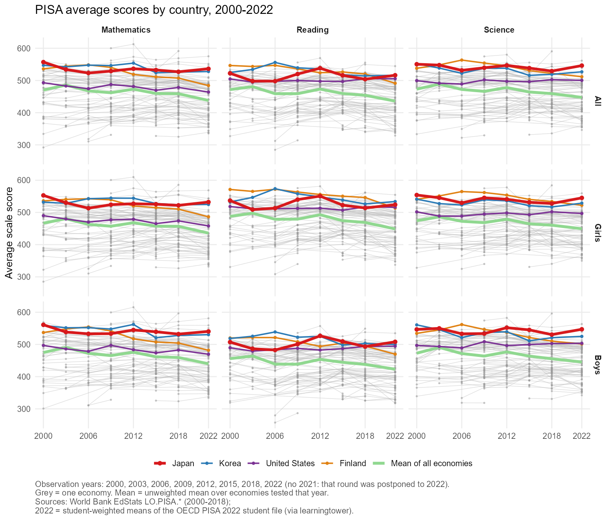
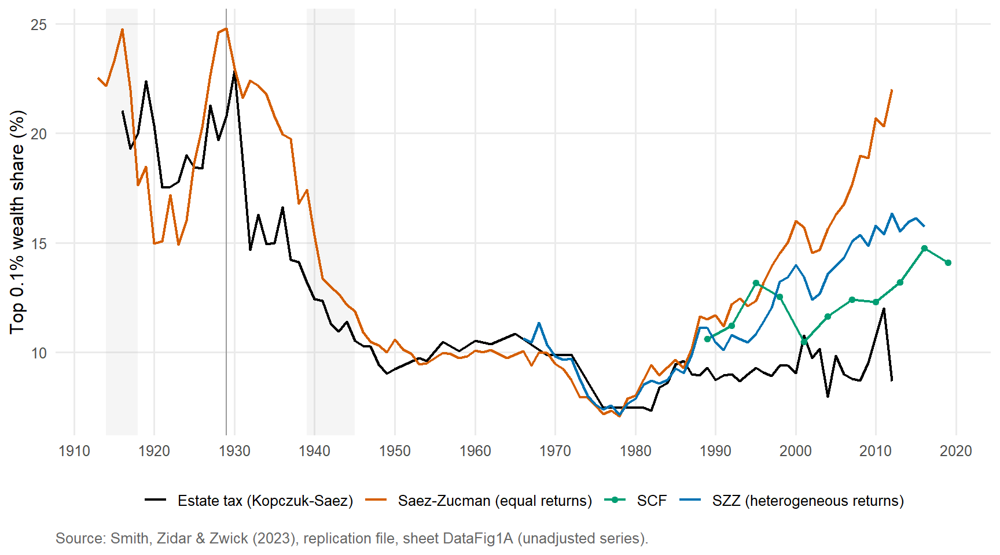
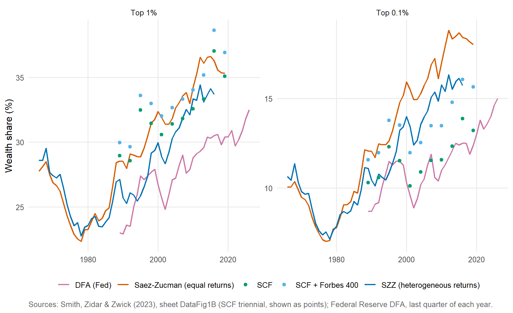
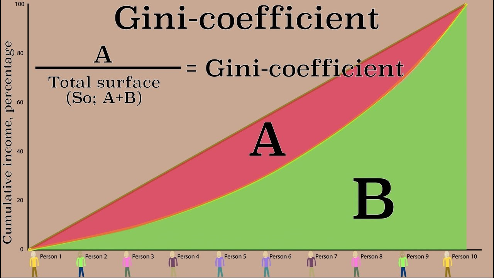
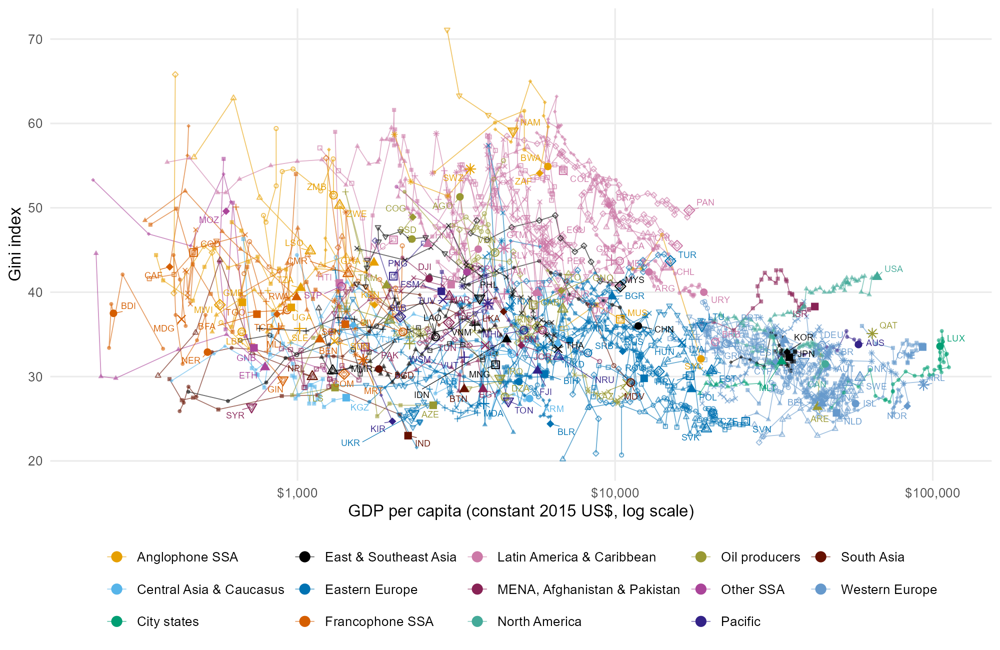
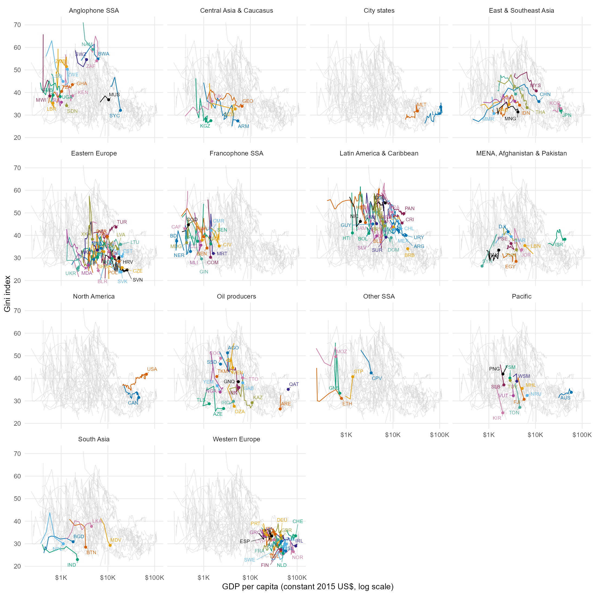

<div class=big-code>
::: {.callout-note appearance="minimal"}
資本市場均衡線が極端に低かったり高かったりする場合とはどういった場合なのか、実際に起こり得ることなのか気になりました。
:::
</div>
<div class=big-code>
::: {.callout-note appearance="minimal"}
貧困の罠についての図で、LでもHでもないMの状況に置かれた際に、頑張るか頑張らないかによって先進か発展途上になるかが変わってきてしまうというのが興味深かったです。

なぜS字は曲線ではなく、直線になるのですか？
:::
</div>
<div class=big-code>
::: {.callout-note appearance="minimal"}
S字のグラフを作成することで貧困の罠というものを説明できることに驚きました。マーシャル・プランによってどのように対処しようと考えていたのかが、S字のグラフを見て理解しやすくなることが分かりました。ただ、グラフの内容自体を理解することがとても難しいです。
:::
</div>

* 資本市場均衡線についてはまっとうな疑問です
    * 前回時間切れでしたので、次回説明します

----

<div class=big-code>
::: {.callout-note appearance="minimal"}
前回の回答に対するアンサーで、調査が2023年に始まったものも存在すると知り、もっと時間をかけて行われてきたものだと思っていたので、コロナ禍以降に始まったものなどもあるとだなと驚きました。資本市場均衡線が極端に低かったり高かったりする場合とはどういった場合なのか、実際に起こり得ることなのか気になりました。
:::
</div>

* ご紹介したのは**2023年に掲載された論文**で、それまでに収集された家計調査データなどを使っています
    * 家計調査自体はだいぶ前から実施されています

----

<div class=big-code>
::: {.callout-note appearance="minimal"}
また課題をやっていて、AIありきで、AIがなかった時代の大学生はすごいなと思いました。
:::
</div>
<div class=big-code>
::: {.callout-note appearance="minimal"}
今回の授業を通して、特に面白いな思ったのはAIの実演でした。AIのクオリティがとても高くて、まだ理解ができない英語の列が沢山流れてきていてびっくりしましたが、指示を的確にする事が重要だと言うことにより気づくことができました。内容がまだ難しくまだついていけない部分が多いので、もっと沢山授業を受けて、理解できるようになりたいです
:::
</div>

* AIやインターネットはおろか、自分のPCすらなかった時代には、学生の書くレポートの内容もその道具の生産性に比例して貧弱でした
    * 全然すごくありません
    * これは伊藤の主観なので、客観的なデータを見つけます
* AI=楽をする道具、ではなく、AI=作業を手早く進める道具、として捉え、より深く掘り下げて考察していただくと有り難いです
    * 昔は道具の生産性が低く、どんぐりの背比べでした
    * 今は道具の生産性が高まった分だけ、使う人の能力が歴然とします
* 用語が難しいときは、素人が分かるように用語を説明しながら出力せよ、と指示してください

----

昔の大学生はすごかった?

:::::: {.columns}
::::{.column width="40%"}

::: {.fragment fragment-index=1}
{height=300}
:::


::::

::::{.column width="60%"}
::: {.fragment fragment-index=2}
* 平均は減少傾向
* 最近の参加国は低学力が多いから?
:::
::::
:::::::


:::::: {.columns}
::::{.column width="40%"}
::: {.fragment fragment-index=3}
{height=300}
:::

::::

::::{.column width="60%"}
::: {.fragment fragment-index=4}
* 2000年観察国に限定
* 平均はほぼ横ばい
* 2000年は初年度で気合いが入っていたから除外
* 日本: 2003年-2022年=似たような水準
:::
::::
:::::::

::: {.fragment}
結論: 昔の大学生は大したことない
:::


----

昔の大学生はすごかった?

今の大学生の方が大変のような気がします

* 昔: アイディアを出して自分で作業する&rarr;どんぐりの背比べ
* 現在: 何かアイディアを出してAIに作業させる

. . .

では、アイディアもAIに出させれば楽では?

* [IdeaLense](https://ideadetector.ai/)(U of Maryland): アイディアがAI出自か検査([BBC podcast](https://bbc.com/audio/play/p0ph3k57))

. . .

懸念: 

* AIは平均値へ回帰する傾向がある&larr;AIの回答は既存情報を使った予測
* アイディアが似てくる &rArr; 革新&darr; &rArr; 進歩&darr;
    * 個人も、人類全体も

. . .

きつさ(アイディアで勝負) $>$ きつさ(努力で勝負)

----

Claude Code

::: {.nonincremental style="font-size: 60%;"}
1. can you find out PISA's scores for partcipating countries\
   end output: time series plot of all countries\
   facet(grades ~ subjects)\
   i will give you auto mode on the condition that you do not touch any existing files
1. what are the files do you work on?
1. good
1. please also work on PISA\
   rows by sex
1. can you make a quarto file of the above and render?
1. can you also download pisa 2022
1. PISA\
   use diff colours for Japan (red bold), Korea, US, Finland, mean line (light green)\
   use lightbox\
   note obs years in figure footnote
1. same colour scheme for TIMSS
1. another figure for PISA\
   fix the countries as countries observed in 2000\
   so compositional changes will be controlled
1. add US and spain to reading
1. for 3rd fig, include all countries observed in 2000\
   for 2nd fig, include all countries
1. you need 2 subsections for PISA
1. for 3rd fig, set ymin = 450 but still use below y min countries to compute mean
:::


----

<div class=big-code>
::: {.callout-note appearance="minimal"}
宿題に関しても難しいと感じるのですが、基礎一つ一つ説明をして頂くことは時間の面で難しいのでしょうか、そもそも基礎知識がないと履修が難しい講義なのでしょうか。また、以前授業前の10分間に結果の共有を行っていたと思うのですが、私は1つ前の授業の教室から4号館へ移動をする必要があるため、興味があっても参加ができません。もし可能でしたら、授業開始後に簡単に説明などを行って頂けませんか？
:::
</div>

* 教室間移動の配慮が足りなかったことをお詫びいたします
* 次回講義冒頭で課題をchatベースで実行する方法をお見せしたいと思います
* chatベースでも実行可能、しかし、ファイルをAIに直接扱わせる方が圧倒的に便利だと分かりました
    a) 複数ファイルを扱うときには面倒\
    &larr;ユーザが複数ファイルに貼り付ける必要がある\
    &larr;無料アカウントではファイル・アップロードは3つまで
    a) AIがRコードの出力を見ながら試行錯誤できない\
    &rarr;ユーザが出力を試行錯誤する必要がある

----

<div class=big-code>
::: {.callout-note appearance="minimal"}
戦争が起きると富の再配分が起き、国内の貧困層と富裕層の差が小さくなるということを知り驚きました。
:::
</div>

* 戦争によって富の分配が平等化する、というのは間違いとまで言えませんが、戦争前からの傾向を無視した一般化でした
    * なぜ戦乱期に平等化するか...
    * 敗戦国一般の状況
    * 第一次大戦後ドイツ特殊の状況
* 1930年代はすべての国で平等化しました
    * なぜか
* 1970年代後半は平等化
* 1980-90年代以降は不平等化

----

<div class=big-code>
::: {.callout-note appearance="minimal"}
戦争が起きると富の再配分が起き、国内の貧困層と富裕層の差が小さくなるということを知り驚きました。
:::
</div>

資産の逆算capitalization method [@SaezZucman2016]
$$
\mbox{資産所得}=\mbox{資産額}×\mbox{収益率}
\quad \Leftrightarrow \quad \mbox{資産額}=\frac{\mbox{資産所得}}{\mbox{収益率}}
$$

入手元

* 資産所得は申告: 個人税務データ
* 収益率は支払側: 株式配当(公開情報)、貸借対照表、損益計算書(上場企業、S類型企業、信託、金融機関など)

. . . 

:::::: {.columns}
::::{.column width="30%"}
```{r, engine = "tikz"}
#| out-width: "90%"
\usetikzlibrary{backgrounds}
\usetikzlibrary{calc}
\newcommand{\mpage}[2]{\begin{minipage}[t]{#1}#2\end{minipage}}

\tikzstyle{block} = [draw, fill=blue!20, rectangle, 
    minimum height=3em, minimum width=4cm]
\tikzstyle{sum} = [draw, fill=blue!20, circle, node distance=1cm]
\tikzstyle{input} = [coordinate]
\tikzstyle{output} = [coordinate]
\tikzstyle{pinstyle} = [pin edge={to-,thin,black}]
% The block diagram code is probably more verbose than necessary
\begin{tikzpicture}[
    scale = .5, auto, node distance=3cm, >=latex,
    show background rectangle, 
    background rectangle/.style={fill=yellow!10}
  ]
    % We start by placing the blocks
    \node [block] (Income) {\begin{minipage}{3cm}\hfil income inequality\\ \hfil * high saving rate\end{minipage}};
    \node [block, right of=Income, xshift = 4.5cm] (AssetAccum) {\begin{minipage}{4.5cm}\hfil high rate of\\\hfil $\phantom{mm}$ asset accummulation\end{minipage}};
    % We draw an edge between the Income and AssetAccum block to 
    % calculate the coordinate u. We need it to place the lir block. 
    \draw [->] (Income) -- (AssetAccum);
    \node [block, below of=AssetAccum] (WIneq) {\begin{minipage}{4.5cm}\hfil wealth\\\hfil $\phantom{mmmmm}$inequality\end{minipage}};
    \node [block, below of=Income] (CapitalIncome) {\begin{minipage}{4.5cm}\hfil capital income\\\hfil $\phantom{mmmmm}$inequality\end{minipage}};
    % Once the nodes are placed, connecting them is easy. 
    \draw [draw, ->] (Income) -- (AssetAccum);
    \draw [draw, ->] (AssetAccum) -- (WIneq);
    \draw [->] (WIneq) -- (CapitalIncome);
    \draw [->] (CapitalIncome) -- (Income);
\end{tikzpicture}
```
::::

::::{.column width="30%"}
{height="4cm"}
::::

::::{.column width="30%"}
{height="4cm"}
::::
:::::::


----

<div class=big-code>
::: {.callout-note appearance="minimal"}
戦争が起きると富の再配分が起き、国内の貧困層と富裕層の差が小さくなるということを知り驚きました。
:::
</div>

アメリカで1980年代から富の不平等化が始まった理由

* 1920-1970年代: 下位90%の富&uarr;
    * 年金
    * 不動産(自宅)
* 1980年代以降: 複数要因が提示されている
    a) 上位層と下位層の貯蓄率格差&uarr;[@SaezZucman2016; @KuhnSchularickSteins2020]
    a) 上位層の株式価値&uarr;[@KuhnSchularickSteins2020; @Gomez2023; @SmithZidarZwick2023]
    a) 新規の富創造&uarr;[@Gomez2023]
    a) 見せかけ: 税制変更(1986)により労働所得を資本所得に区分変更 &rArr; 資産額が膨張[@Kopczuk2015]


----

<div class=big-code>
::: {.callout-note appearance="minimal"}
戦争が起きると富の再配分が起き、国内の貧困層と富裕層の差が小さくなるということを知り驚きました。
:::
</div>

----

<div class=big-code>
::: {.callout-note appearance="minimal"}
私は、今回の授業を通じて経済成長と社会全体の豊かさは必ずしも一致しないのではないかと考えた。特に印象に残ったのは、アフリカの一部地域における富の偏在と、植民地支配の歴史が現在の格差に与える影響である。

まず、植民地時代に生じた不平等は、現在の社会にも影響を残している可能性があると感じた。例えば、当時、土地や資源、教育機会などを有利に得られた人々と、そうした機会を制限されていた人々との間には、経済的な格差が生じたと考えられる。さらに、資産や教育機会の違いが次の世代にも引き継がれることで、独立後も格差が残る可能性がある。このことから、現在の経済格差を理解するためには、個人の努力だけでなく、歴史的な背景や社会制度にも目を向ける必要があると考えた。

また、GDPが高いことと、人々の生活が豊かであることは同じなのだろうか。仮に国全体のGDPが増加しても、その利益が一部の富裕層に集中していれば、多くの人々の生活が改善されるとは限らない。授業で扱った富の偏在についても、国全体の経済規模だけでは、国民の間にどのような格差が存在しているのかを十分に把握できないと感じた。

この2点を踏まえると、経済発展を評価する際には、経済成長率や1人当たりGDPだけでなく、富の分配や教育機会、生活環境なども考慮する必要があるのではないだろうか。歴史的に不利な立場に置かれた人々が、現在も経済的な機会を得にくい状況にあるとすれば、国全体の経済成長だけでは格差の解消につながらない可能性がある。経済成長を実現することと、その成果を社会全体の豊かさにつなげることは、別の課題なのではないかと考えた。
:::
</div>

----

<div class=big-code>
::: {.callout-note appearance="minimal"}
1. 経済成長と社会全体の豊かさは必ずしも一致しない
    * 国全体のGDPが増加しても、その利益が一部の富裕層に集中していれば、多くの人々の生活は改善されない
1. 植民地時代に生じた不平等は、現在の社会にも影響を残している可能性がある
    * 資産や教育機会の違いが次の世代にも引き継がれる
    * 個人の努力だけでなく、歴史的な背景や社会制度にも目を向ける必要がある
1. 経済発展の評価軸
    a) 成長: 経済成長率、1人当たりGDP
    a) 分配: 富の分配、生活環境
    a) 機会: 教育機会
:::
</div>

1. 成長の恩恵が及ぶのが少数か多数か
    * 東アジア型: 労働集約的産業生産&uarr; &rArr; 多数の所得&uarr; &rArr; 平等化
    * 資源中心型: 資本集約的産業生産&uarr; &rArr; 少数の所得&uarr; &rArr; 不平等化
1. 世代間経済的可動性intergenerational economic mobility
    * 所得(資産)遷移
    * 人的資本の蓄積機会は均等か


----

<div class=big-code>
::: {.callout-note .nonincremental appearance="minimal"}
1. 経済成長と社会全体の豊かさは必ずしも一致しない
    * 国全体のGDPが増加しても、その利益が一部の富裕層に集中していれば、多くの人々の生活は改善されない
1. 植民地時代に生じた不平等は、現在の社会にも影響を残している可能性がある
    * 資産や教育機会の違いが次の世代にも引き継がれる
    * 個人の努力だけでなく、歴史的な背景や社会制度にも目を向ける必要がある
1. 経済発展の評価軸
    a) 成長: 経済成長率、1人当たりGDP
    a) 分配: 富の分配、生活環境
    a) 機会: 教育機会
:::
</div>

3. 経済全体の評価をどうするか=社会的厚生関数social welfare function
    * (人々の選好順位と合理性に矛盾しない)SWFは存在しない: 個人の厚生を積み上げて社会全体の厚生値にすることはできない
    * よって、評価軸は客観的に選べず、どう選んでも主観的になる
    * しかし、成長と分配は古典的な対照軸、機会は成長と分配を説明する概念なので、バランスが取れている


----

:::::: {.columns}
::::{.column width="40%"}
{height=200}

::: {.fragment}
{height=300}
:::
::::

::::{.column width="60%"}
不平等度指数: ジニ係数Gini coefficient

* 横軸: 貧しい順に右に行くほど豊か
* 縦軸: 累積合計
* 曲線: 百分位数(横軸上のポイント)までの所得累計が全体に占める割合(=分布関数=Lorentz curve)
    * 45度線: すべての人が同じ所得を持つ場合
    * _|線: 1人がすべての所得を持つ場合
* ジニ係数=A/(A+B)
    * 0: すべての人が同じ所得を持つ場合
    * 1: 1人がすべての所得を持つ場合
::::
:::::::

* 低所得ほど縦方向の動きが大きい
    * ジニ係数の計測誤差が大きい
* ラテンアメリカ諸国はジニ係数が高い


----

Eyeball check: 成長と分配の一般的な傾向は見出せない

:::::: {.columns}
::::{.column width="40%"}
::: {.fragment fragment-index=3}
{height=600}
:::

::::

::::{.column width="60%"}
::: {.fragment fragment-index=4}
* 産油国、太平洋諸国は平等化成長
* 東アジア、東南アジアは逆U字
:::
::::
:::::::

----
