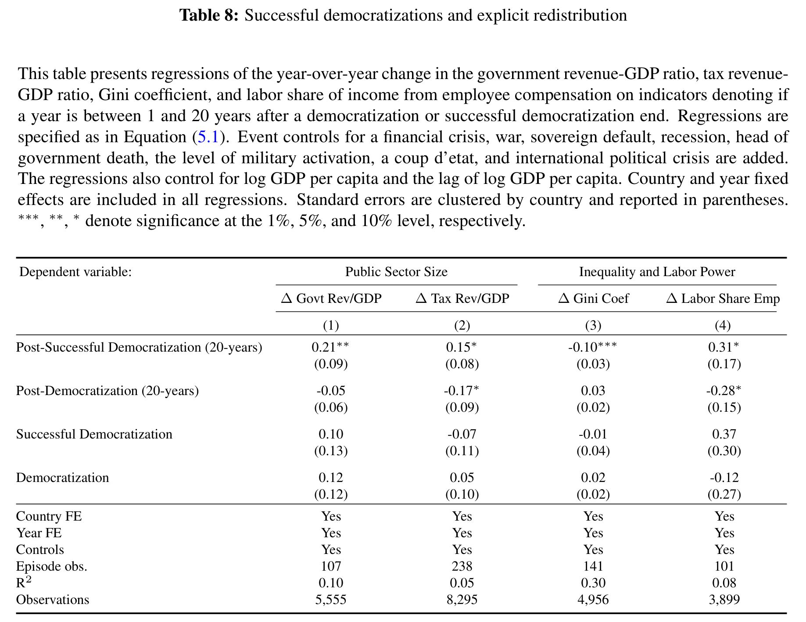
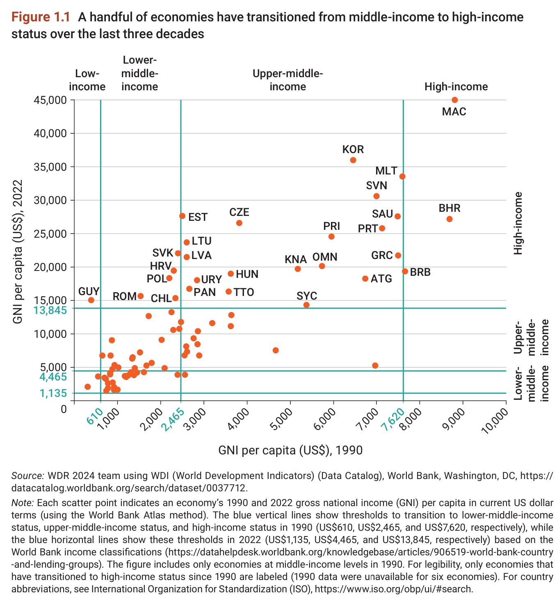
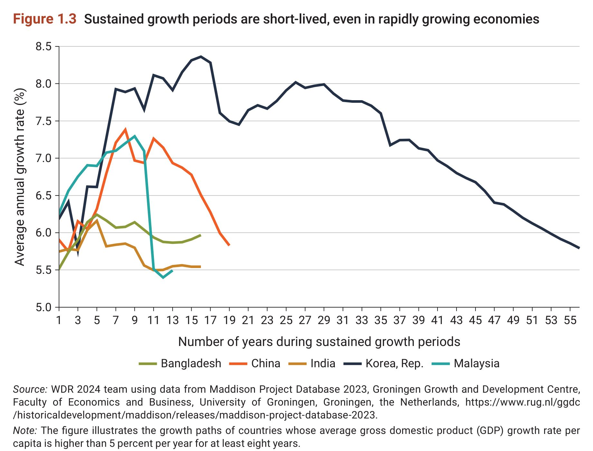
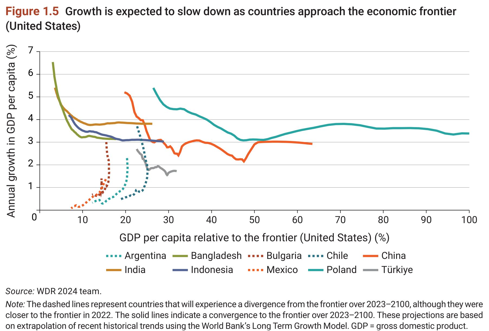

<div class=big-code>
::: {.callout-note appearance="minimal"}
J-PALの研究によって効果が確認された政策でも、どこにでも通用する政策はなく、国や地域によって効果に差が生じてしまうと思います。そうなると、政治体制や文化や国民性の違いという結論になるのでしょうか。
:::
</div>

* これを回答できれば世界が喜ぶでしょう
* 各国で違うのは、政治体制、文化、国民性に留まりませんが、仮にこの3つだとしましょう

    $$ 
    \mbox{効果}=a+b_{1}\mbox{政治体制}+b_{2}\mbox{文化}+b_{3}\mbox{国民性}+e
    $$
    * 効果(左辺)を説明する変数(右辺)を説明変数explanatory variablesといいます
    * $e$は誤差項error term

----

<div class=big-code>
::: {.callout-note appearance="minimal"}
J-PALの研究によって効果が確認された政策でも、どこにでも通用する政策はなく、国や地域によって効果に差が生じてしまうと思います。そうなると、政治体制や文化や国民性の違いという結論になるのでしょうか。
:::
</div>

<!--* 2国で政策効果が異なったとき、理由を政治体制に帰しても、文化や国民性の違いが原因かもしれません-->
* 国の数が2(国1の効果が1、国2の効果が2)の場合、両方の平均値(1.5)からの乖離(-.5, .5)を説明させる特徴の数は1までです
    * 政治体制(=民主主義)を説明要因とすると、民主主義だと政策効果が平均値よりも.5増える、などと説明可能です
    * 文化や国民性を説明要因に加えようとしても、説明すべき乖離は残っていません
    * 乖離は政治体制だけで説明し尽くされているからです
* 国の数=標本サイズ
* 説明変数の個数は標本サイズ-1までしか使えません
    * 1は平均値の分です
    * 標本サイズ-(説明変数の個数+1)を自由度degree of freedomといいます
    * 最初の2か国の例では、政治体制を加えたところで自由度0[=2-(1+1)]です
* 国の数を多く集めて標本サイズを増やせば、説明変数を増やすことができます

----

<div class=big-code>
::: {.callout-note appearance="minimal"}
富の再分配のところで税金で調節のようなことをできるというのが今回の新しい気づきでした。結局どの国が均等に再分配できているのか考えると福祉などがしっかりしているノルウェーなどの北欧の国なのかな、などと考えました。しかし日本などでもよく問題になっていますが政治家が税金として集めたお金を使ってしまうようなことがあったら得をするのは納税額が少ない物なのかな？とも思い、結局高額納税者はあまり得がないのではないか、良い分配ではないのではないかと思いました。ただ公平性などを考えたらキリがないのでしょうか。
:::
</div>

* California: Wealth tax?
    * 一回限り、富税収の充当先は連邦政府拠出分が削減された社会保障
    * 超富裕層の州外脱出、Google創業者セルゲイ・ブリンの反対ロビーイング
    * 社会保障には恒久財源が必要、一回きりの財源は適切ではない
* 理論: 富課税は経済全体の生産性と成長を高める[@Guvenenetal2023]
    * 富課税: 富が同じならば納税額は同じ
    * 資産所得課税: 所得が同じならば納税額は同じ
    * 資産所得課税&rarr;富課税\
        &rArr; 富保有が同じならば高所得(=高生産性)の人ほど減税 \
        &rArr; 課税負担が低生産性の富保有者に移行 &larr; 富保有が大きくても所得の低い人がいる\
        &rArr; 高所得富保有者の手元資金&uarr;

----

<div class=big-code>
::: {.callout-note appearance="minimal"}
富の再分配のところで税金で調節のようなことをできるというのが今回の新しい気づきでした。結局どの国が均等に再分配できているのか考えると福祉などがしっかりしているノルウェーなどの北欧の国なのかな、などと考えました。しかし日本などでもよく問題になっていますが政治家が税金として集めたお金を使ってしまうようなことがあったら得をするのは納税額が少ない物なのかな？とも思い、結局高額納税者はあまり得がないのではないか、良い分配ではないのではないかと思いました。ただ公平性などを考えたらキリがないのでしょうか。
:::
</div>

* 実証
    * デンマークでの富課税廃止[@Jakobosenetal2020, 1991年]
        * 上位0.4%の富が8年で30%&uarr;
        * 上位0.5-5%の課税対象の富は30年で20%&uarr;
    * コロンビアの富課税変更[@LondonoVelezAvilaMahecha2025, 2003, 2006, 2010, 2014]
        * パナマ文書をきっかけに富裕層の税申告データが公開
        * 税務当局が検証できない項目(債務過大申告、資産過少申告)に富を隠す
        * タックスヘイブンに隠す
        * 富課税が廃止されても継続

----

<div class=big-code>
::: {.callout-note appearance="minimal"}
富の再分配のところで税金で調節のようなことをできるというのが今回の新しい気づきでした。結局どの国が均等に再分配できているのか考えると福祉などがしっかりしているノルウェーなどの北欧の国なのかな、などと考えました。しかし日本などでもよく問題になっていますが政治家が税金として集めたお金を使ってしまうようなことがあったら得をするのは納税額が少ない物なのかな？とも思い、結局高額納税者はあまり得がないのではないか、良い分配ではないのではないかと思いました。ただ公平性などを考えたらキリがないのでしょうか。
:::
</div>

* 実証
    * スペインでの富課税[@MasMontserrat2025; 2011]
        * 控除を活用して富課税逃れ
        * 税率1%&uarr; &rArr; 4年で課税対象資産3.21%&darr;
        * 資産変更が富課税減収の92.6%を説明
        * 4年間の富課税減収額=推計富税収の2.75年分

----

<div class=big-code>
::: {.callout-note appearance="minimal"}
富の再分配のところで税金で調節のようなことをできるというのが今回の新しい気づきでした。結局どの国が均等に再分配できているのか考えると福祉などがしっかりしているノルウェーなどの北欧の国なのかな、などと考えました。しかし日本などでもよく問題になっていますが政治家が税金として集めたお金を使ってしまうようなことがあったら得をするのは納税額が少ない物なのかな？とも思い、結局高額納税者はあまり得がないのではないか、良い分配ではないのではないかと思いました。ただ公平性などを考えたらキリがないのでしょうか、、。
:::
</div>

* 実証
    * 北欧諸国富課税の国外移住効果[@Jakobsenetal2026]
        * 税率1%&uarr; &rArr; 富裕層人口2%&darr;
        * 税率1%&uarr; &rArr; 雇用.02%&darr;、投資.07%&darr;、GDP.10%&darr;
    * ノルウェイの法人資産課税効果[@Ring2026]
        * 上位.1%富裕層(100人)が国外に移住
        * 富税収の増加: 75%&uarr; (移住なし) &rArr; 71.5%&uarr; (移住あり)
        * 移住者の企業は国内生産継続、投資額・倒産数は不変

----

<div class=big-code>
::: {.callout-note appearance="minimal"}
今回の授業で最も印象に残ったのは、戦争に敗れた国ほど富の平等化が進みやすいという話です。当初は、戦争で国全体が貧しくなるなら格差も広がるのではないかと考えていましたが、実際には、機械や工場といった資本が破壊され、富裕層の資産の価値が失われる。さらにインフレや財産税、財閥解体、農地改革などの政策も重なり、上に立つ人々の富が大きく削られ、戦後の平等化は貧しい人が豊かになったからではなく、豊かな人が貧しくなったことで生じた「下方への平準化」だと理解しました。

平等化が成長に寄与するのは、人的資本や制度が残っている場合に限られるのではないか。それらまで破壊された国では、資本が失われたことで平等になっても、そのまま貧困の罠に陥るのではないかとも思いました。また、現代の途上国で紛争後に復興支援を行う際、資本の再建だけでなく、教育や制度の再建を優先すべきかどうかも気になりました。今後の授業で、戦後復興が成功した国と失敗した国の違いについて学びたいです。
:::
</div>

* 日独の戦後復興がめざましかったのは人的資本は壊されなかったため、という説明があります
* 人的資本を蓄積するのは時間がかかります
    * 人間が増えたうえで、教育をするからです
* 借入なしの場合、貯蓄と消費の組み合わせの最適化問題
    * 消費と貯蓄(=投資)に所得をどう振り分けるか
    * 消費を重視するならば、投資は減る

----

<div class=big-code>
::: {.callout-note appearance="minimal"}
今回の授業で最も印象に残ったのは、戦争に敗れた国ほど富の平等化が進みやすいという話です。当初は、戦争で国全体が貧しくなるなら格差も広がるのではないかと考えていましたが、実際には、機械や工場といった資本が破壊され、富裕層の資産の価値が失われる。さらにインフレや財産税、財閥解体、農地改革などの政策も重なり、上に立つ人々の富が大きく削られ、戦後の平等化は貧しい人が豊かになったからではなく、豊かな人が貧しくなったことで生じた「下方への平準化」だと理解しました。

平等化が成長に寄与するのは、人的資本や制度が残っている場合に限られるのではないか。それらまで破壊された国では、資本が失われたことで平等になっても、そのまま貧困の罠に陥るのではないかとも思いました。また、現代の途上国で紛争後に復興支援を行う際、資本の再建だけでなく、教育や制度の再建を優先すべきかどうかも気になりました。今後の授業で、戦後復興が成功した国と失敗した国の違いについて学びたいです。
:::
</div>

1960年代以降も富分配が平等化した理由の一つ[@Miller2026]

:::::: {.columns}
::::{.column width="75%"}
* 権威主義体制&rarr;民主化
* 民主化 &rArr; 株価下落 &larr; 資産再配分のリスク&uarr;

    $$
    \mbox{株価}=\frac{\mbox{配当額}}{\mbox{配当性向}}　\; \Leftrightarrow \; \mbox{配当性向}=\frac{\mbox{配当額}}{\mbox{株価}}
    $$
* クローニー資本主義crony capitalism(腐敗したエリート体制)の資産が分配されるリスク &rArr; 株価下落
::::

::::{.column width="20%"}
::: {.fragment}
{.lightbox width="70%"}
:::

* 税収&uarr;
* 所得Gini&darr;
::::
:::::::


----

<div class=big-code>
::: {.callout-note appearance="minimal"}
私は今まで、貧困とは敗戦や植民地支配といった歴史的負の遺産（ハンデ）に由来する問題であり、貧困から抜け出せないのは、世界の経済秩序に構造的な問題があるからだと思っていたため、貧困解決に至らない理由を「そもそも国が豊かになろうとしていない」と捉え、それ対する一つのアプローチ方法として「放っておく」という選択があることに驚いた。世銀などが開発しようとしても貧困から抜け出せない国がある場合、それは政府の資金の運用に問題があるのでしょうか？
:::
</div>

* 低所得から抜け出すためには、さまざまな要素が揃う必要があります
    * エネルギー、上下水道、交通、通信、保健など生活・生産インフラ
    * 司法、行政などの制度インフラ
    * 治安、国防、福祉などの安全保障
    * 教育、金融など重要産業
* 南スーダンのように何もない状態から作り上げるのは時間がかかります
* これらは家計や企業に供給されるサービス
* 家計や企業が需要して効率的に活用する必要があります
* 効率的な需要と供給を作り上げるのは至難の業

----

<div class=big-code>
::: {.callout-note appearance="minimal"}
私は今まで、貧困とは敗戦や植民地支配といった歴史的負の遺産（ハンデ）に由来する問題であり、貧困から抜け出せないのは、世界の経済秩序に構造的な問題があるからだと思っていたため、貧困解決に至らない理由を「そもそも国が豊かになろうとしていない」と捉え、それ対する一つのアプローチ方法として「放っておく」という選択があることに驚いた。世銀などが開発しようとしても貧困から抜け出せない国がある場合、それは政府の資金の運用に問題があるのでしょうか？
:::
</div>

* 中所得国になっても、自前で技術進歩を成し遂げないと高所得国になれない[@WDR2024]

. . .

::::::{style="text-align: center;"}
::::{.column width="90%"}
```{r, engine = "tikz"}
#| out-width: "90%"
\usetikzlibrary{backgrounds}
\usetikzlibrary{calc}
\newcommand{\mpage}[2]{\begin{minipage}[t]{#1}#2\end{minipage}}

\tikzstyle{block} = [draw, fill=blue!20, rectangle, 
    minimum height=3em, minimum width=4cm]
\tikzstyle{sum} = [draw, fill=blue!20, circle, node distance=1cm]
\tikzstyle{input} = [coordinate]
\tikzstyle{output} = [coordinate]
\tikzstyle{pinstyle} = [pin edge={to-,thin,black}]
% The block diagram code is probably more verbose than necessary
\begin{tikzpicture}[
    scale = .95, auto, node distance=4cm, >=latex,
    show background rectangle, 
    background rectangle/.style={fill=yellow!10}
  ]
    % We start by placing the blocks
    \node [block] (Low) {Low income};
    \node [block, right of=Low, xshift = 4.5cm] (LowMid) {Lower middle income};
    \node [block, right of=LowMid, xshift = 4.5cm] (HighMid) {Higher middle income};
    \node [block, right of=HighMid, xshift = 4.5cm] (High) {High income};
    % Once the nodes are placed, connecting them is easy. 
    \draw [->] (Low) -- (LowMid) node [midway, below] {increased investment}; 
    \draw [->] (LowMid) -- (HighMid) node [midway, below] {\begin{minipage}{4.5cm}\hfil infusion of \\ $\phantom{mm}$existing technology\end{minipage}};
    \draw [->] (HighMid) -- (High) node [midway, below] {\begin{minipage}{4.5cm}\hfil innovation of \\$\phantom{mmm}$ new technology\end{minipage}};
\end{tikzpicture}
```
::::
::::::

:::::: {.columns}
::::{.column width="40%"}

::: {.fragment}
{.lightbox width="30%"}
{.lightbox width="30%"}
{.lightbox width="30%"}
:::


::::

::::{.column width="60%"}
::: {.fragment}
* 高所得(世銀分類)に移行した国は結構多い
* 5%以上の成長率は長続きしない
* アメリカの1/4の水準で成長が停滞する経済も複数ある
:::
::::
:::::::

* 政策なので政府の課題ですが、蓄積に時間のかかる人的資本による技術進歩を起こすまでは、韓国ですら50年以上かかりました


----

<div class=big-code>
::: {.callout-note appearance="minimal"}
経済成長と富の分配の間には必ずしも一定の関係がないという点が印象に残りました。特に、経済発展を評価する基準として成長・分配・機会の３つが挙げられていましたが、これらをどのように評価するべきなのか疑問に思いました。

例えば、国民全体の所得が低くても格差が小さい国と、格差は大きくても貧困層の生活水準が比較的高い国では、どちらが経済的に発展しているといえるのでしょうか。ジニ係数は所得の不平等を数値として示すことはできますが、その数値だけでは人々が実際にどのような生活を送っているのかまではわからないと思います。

また、所得格差を縮小することと、貧困そのものを解消することは、必ずしも同じではないのではないでしょうか。仮に経済成長によって貧困層の所得が増加しても、それ以上に富裕層の所得が増加すれば、格差は拡大する可能性があります。この場合、格差が拡大したことを経済発展の問題として捉えるべきなのか、それとも貧困層の生活が改善されたことを評価するべきなのか、判断が難しいと感じました。
:::
</div>

* [$\beta$-convergence](04/convergence/SigmaConvergencePlot.html#fig-dist-sim): 低所得国の方が成長が早い
* [$\sigma$-convergence]((04/convergence/SigmaConvergencePlot.html#fig-dist-sim)): 各国所得の分散が小さくなる
    * キャッチアップ=$\sigma$-convergence
    * $\beta$-convergenceでも、分散は小さくならない場合がある
        * 理論的な可能性に過ぎない
        * 国レヴェルで現実妥当性は相当低い
        * アメリカの郡所得収斂では成立


----

<div class=big-code>
::: {.callout-note appearance="minimal"}
経済成長と富の分配の間には必ずしも一定の関係がないという点が印象に残りました。特に、経済発展を評価する基準として成長・分配・機会の３つが挙げられていましたが、これらをどのように評価するべきなのか疑問に思いました。

例えば、国民全体の所得が低くても格差が小さい国と、格差は大きくても貧困層の生活水準が比較的高い国では、どちらが経済的に発展しているといえるのでしょうか。ジニ係数は所得の不平等を数値として示すことはできますが、その数値だけでは人々が実際にどのような生活を送っているのかまではわからないと思います。

また、所得格差を縮小することと、貧困そのものを解消することは、必ずしも同じではないのではないでしょうか。仮に経済成長によって貧困層の所得が増加しても、それ以上に富裕層の所得が増加すれば、格差は拡大する可能性があります。この場合、格差が拡大したことを経済発展の問題として捉えるべきなのか、それとも貧困層の生活が改善されたことを評価するべきなのか、判断が難しいと感じました。
:::
</div>

:::::: {.columns}
::::{.column width="60%"}

::: {.fragment}
[Great Gatsby Curve](): 

不平等と異世代間所得弾力性は正相関
:::


::::

::::{.column width="40%"}
::: {.fragment}
{.lightbox width="20%"}
:::
::::
:::::::

* Gini&uarr; $\sim$ 世代間所得相関&uarr; = 機会が同じ家系に偏り&uarr;\
&rArr; 革新&darr; \
&rArr; 成長&darr;
* 不平等だと成長が低下する(かも)&larr; 不平等以降の因果関係は立証されていない

----

<div class=big-code>
::: {.callout-note appearance="minimal"}
経済成長と富の分配の間には必ずしも一定の関係がないという点が印象に残りました。特に、経済発展を評価する基準として成長・分配・機会の３つが挙げられていましたが、これらをどのように評価するべきなのか疑問に思いました。

例えば、国民全体の所得が低くても格差が小さい国と、格差は大きくても貧困層の生活水準が比較的高い国では、どちらが経済的に発展しているといえるのでしょうか。ジニ係数は所得の不平等を数値として示すことはできますが、その数値だけでは人々が実際にどのような生活を送っているのかまではわからないと思います。

また、所得格差を縮小することと、貧困そのものを解消することは、必ずしも同じではないのではないでしょうか。仮に経済成長によって貧困層の所得が増加しても、それ以上に富裕層の所得が増加すれば、格差は拡大する可能性があります。この場合、格差が拡大したことを経済発展の問題として捉えるべきなのか、それとも貧困層の生活が改善されたことを評価するべきなのか、判断が難しいと感じました。
:::
</div>

::: {style="font-size: 60%;line-height: 1.1;"}
> It is true, of course, that a community must draw on a stream of <Red>fresh talent, in order to avoid stagnation</Red>, and that, unless individuals of ability can turn their powers to account, they are embittered by a sense of defeat and frustration. The existence of <Red>opportunities</Red> to move from point to point on an economic scale, and <Red>to mount from humble origins</Red> to success and affluence, is a condition, therefore, <Red>both of social well­being and of individual happiness</Red>, and impediments which deny them to some, while lavishing them on others, are injurious to both. But opportunities to “rise” are not a substi­tute for a large measure of practical equality, nor do they make immaterial the existence of sharp disparities of income and social condition. On the contrary, it is only the presence of a high degree of practical equality which can diffuse and generalize opportunities to rise. The existence of such oppor­tunities in fact, and not merely in form, depends, not only upon an open road, but upon <Red>an equal start</Red>. It is precisely, of course, when capacity is aided by a high level of general well­being in the milieu surrounding it, that its ascent is most likely to be regular and rapid, rather than fitful and intermittent.\
> R.H. Tawney
:::

* 貧しい才能を阻むと社会が衰える

----

<div class=big-code>
::: {.callout-note appearance="minimal"}
実験に向いているのは比較的小さな政策で、不可逆な政策や大規模政策は実験に不向きという話については少し不思議に思いました。私の考えでは、小さな変化では結果もあまり現れないのでは？と考えていたので、実際はその逆なのかと気付かされました。
:::
</div>

* 小さい政策の方が実験しやすい、という「都合の話」です
* 正しい: 政策の規模&darr; &rArr; 効果&darr;
* しかし、政策の規模&uarr; &rArr; 効果計測不可という場合あり\
  比較対照となる統御群がいなくなるため


----

<div class=big-code>
::: {.callout-note appearance="minimal"}
Banerjee, Abijit, and Esther Dufloの話の中で、”Save them” “Can’t save them”の二つの考えが出ていましたが、私は後者の方がいいのかなと思いました。途上国に対する支援はもちろん必要だと思いますが、他国が一方的に与えるということは持続可能性の観点から効果的であるとは言えません。そもそも、いくら先進国といえど、タダで支援することはあるのでしょうか。支援自体は無償で行ったとしても、後々その恩を振りかざして資源や土地の利権を掻っ攫っていくのではないかと考えてしまいます。そして、もう一つの弊害は国内産業が育たないからです。例えば、食糧不足だから小麦を他国から供給されたとします。その国固有の作物が売れなくなってしまえば、現役の農家の人々の暮らしが立ち行かなくなる上、将来の一次産業従事者の減少を招くと考えられます。これらの弊害を避けるためにも、完全に他国に頼り切った支援ではなく、持続可能な支援が必要になってくるのではないかと思いました。
:::
</div>

* 無償援助と有償援助はきれいに分けられない
    * 無償援助: 返済義務なし
        * 付帯条項あり&larr;利権
            * 中国: 橋を無償で建設しても労働者は中国から派遣
            * 鉱物資源への援助は掘削権とセット
    * 有償援助: 返済義務あり
        * 利子率が低く設定されているために無償要素がある

----

<div class=big-code>
::: {.callout-note appearance="minimal"}
Banerjee, Abijit, and Esther Dufloの話の中で、”Save them” “Can’t save them”の二つの考えが出ていましたが、私は後者の方がいいのかなと思いました。途上国に対する支援はもちろん必要だと思いますが、他国が一方的に与えるということは持続可能性の観点から効果的であるとは言えません。そもそも、いくら先進国といえど、タダで支援することはあるのでしょうか。支援自体は無償で行ったとしても、後々その恩を振りかざして資源や土地の利権を掻っ攫っていくのではないかと考えてしまいます。そして、もう一つの弊害は国内産業が育たないからです。例えば、食糧不足だから小麦を他国から供給されたとします。その国固有の作物が売れなくなってしまえば、現役の農家の人々の暮らしが立ち行かなくなる上、将来の一次産業従事者の減少を招くと考えられます。これらの弊害を避けるためにも、完全に他国に頼り切った支援ではなく、持続可能な支援が必要になってくるのではないかと思いました。
:::
</div>

* 食料援助 &rArr; 農産物価格&darr;  &rArr; 現地農家生産&darr;
    * disincentive effects of food aidは確認できない[@Abdulai2005]、確認できるという指摘もあるが未公刊
* 現金移転 &rArr; 国内価格&uarr;  &rArr; コスト&uarr;  &rArr; 生産&darr;
    * 移転問題tranfer paradox
    * 理論的な可能性で現実妥当性は低い
    * 輸出&darr;は可能性高い


----

<div class=big-code>
::: {.callout-note appearance="minimal"}
AIに全てやってもらうと言うよりは、アイデアは人間が考えてAIに指示を出すということで、価値が出てくるということが分かりました。最近、AIの進化が目まぐるしいので、**いずれ人間が考えつくアイデアがAIの考えを超えることができなくなる日が来るのではないか**と不安に思ってしまいます。しかし、そう考え無気力になっても意味が無いため、AIの助けを借りつつ、自分のアイデアを盛り込んで作り出していくということを続けていこうと考えました。
:::
</div>

* そんなことはありません
* AIとはdeep neural netモデルによる予測: データを学習し、既存のデータから予測
* 予測には平均への回帰regression toward the mean傾向がある(Galton's fallacy)
    * 親より身長の高い子どもが生まれる確率-親より身長の低い子どもが生まれる確率
        * 高身長の親: 負
        * 低身長の親: 正
        * [Victor Wembanyama (224cm)](https://www.nba.com/player/1641705/victor-wembanyama)
    * 生物学的に身長の上限、下限があるため
    * 上下限がある現象ならば平均への回帰がある
* AIの出すアイディアも平均に回帰=つまらなくなっていく

----


