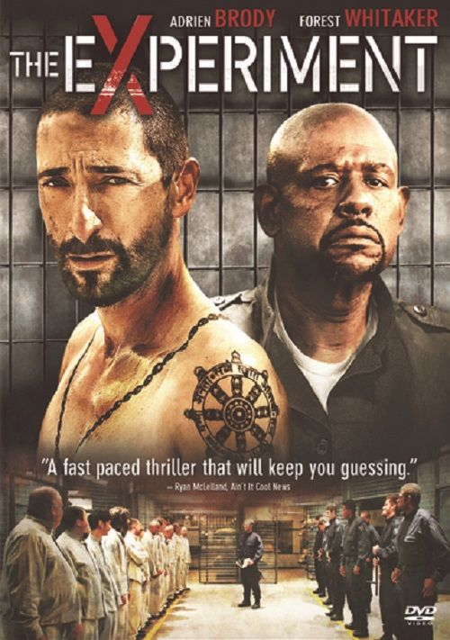
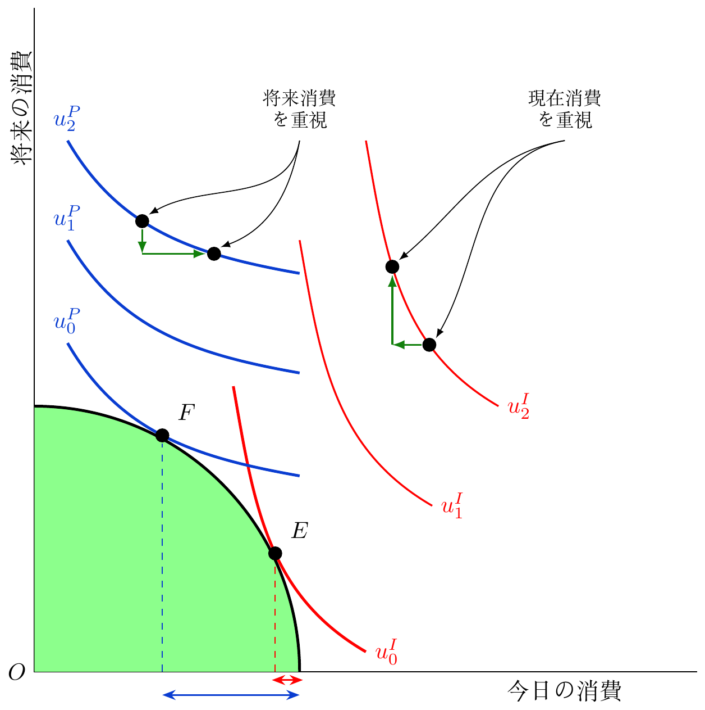
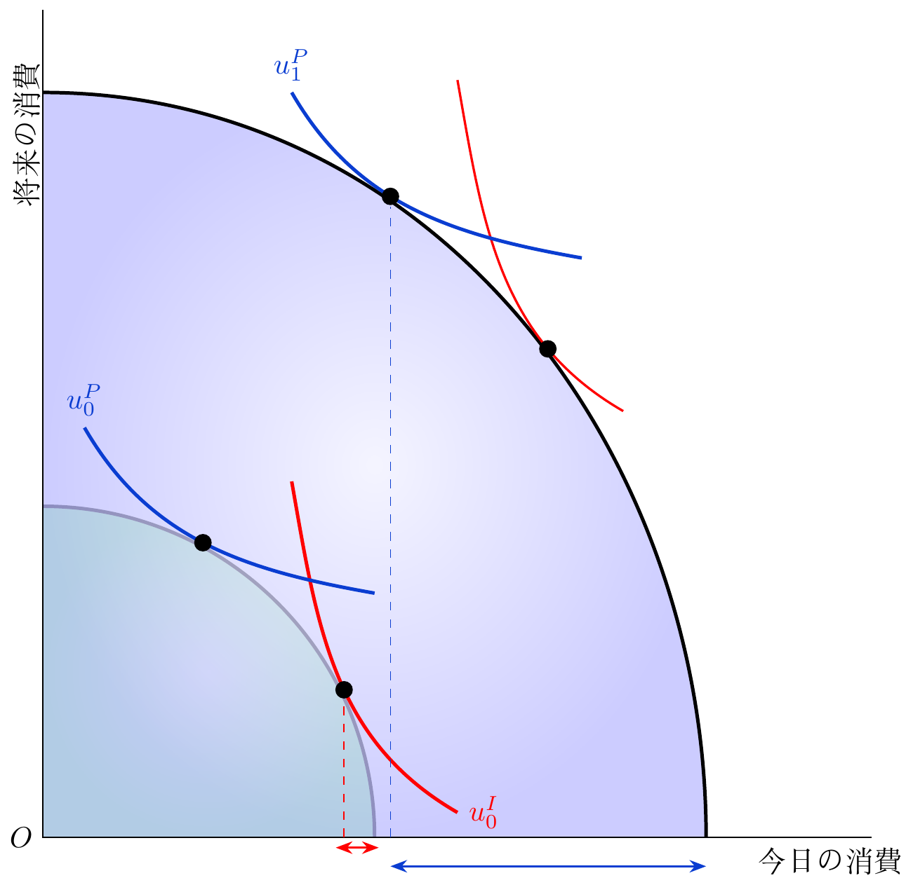
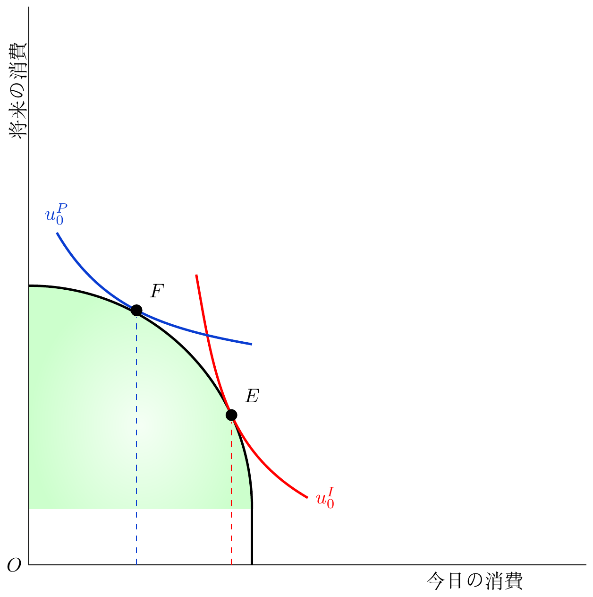
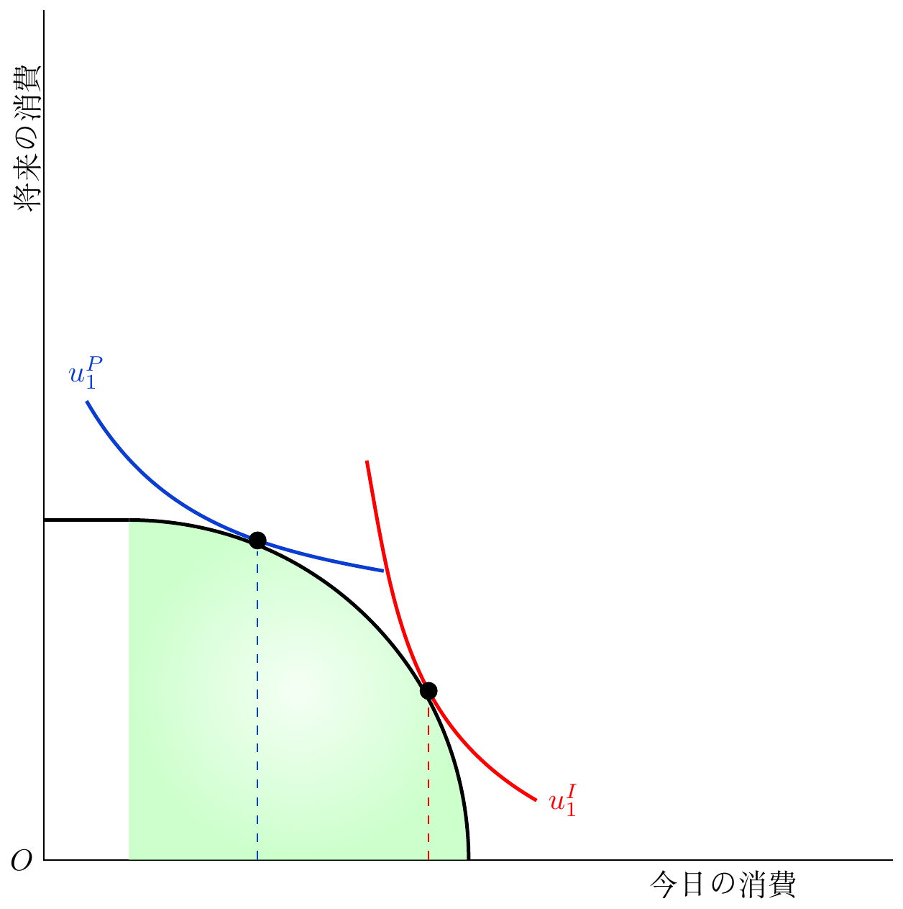
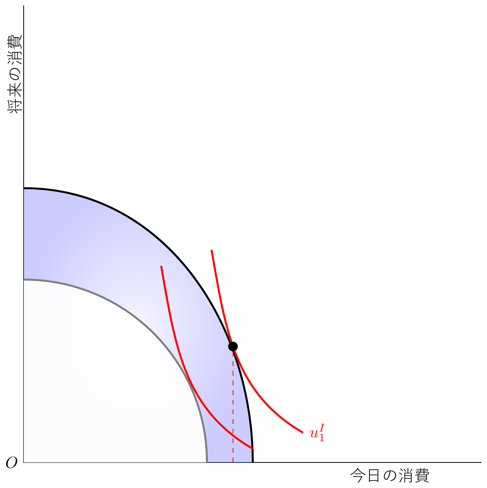

<div class=big-code>
::: {.callout-note appearance="minimal"}
$\sigma$-収束のプロットを見ることで、地域や国の格差が時代とともにどう変化してきたかが直感的に分かり、とても面白かったです。単に「格差が縮まった」というだけでなく、全体として平準化しつつも時期によって縮小が停滞・再拡大している点にリアルさを感じました。

数字や計算だけでなく、グラフの推移から「世の中がどう変わってきたか」という背景のストーリーを感じ取ることができたので、グラフが大きく動いた時期にどんな経済ショックや出来事があったのか、さらに詳しく調べてみたいと思いました。
:::
</div>

* 格差をどうやって表現するのか
    * Gini係数=数字&rarr;把握は明確&rarr;集計(詳細損失)
    * ヒストグラム、確率密度分布=視覚&rarr;把握は感覚&rarr;詳細(全体未整理)
* データをまず得ることが大事です
* 変化の原因を探るのは、実はとても難しいです
    * ミクロ(個別)政策: インパクト評価
    * マクロ(集計)政策: さまざまな要因があるので、一部の要因だけを取り上げる経済モデルを仮定し、効果を計算


---

<div class=big-code>
::: {.callout-note appearance="minimal"}
　政策担当者と比較してNGOは能力やモラルが高いということに驚き、そのような能力、モラルの差ができてしまう理由が気になりました。
:::
</div>

* 一般化しすぎたと反省していますが、平均的に途上国の政策担当者(とくに地方自治体)よりも、使命感を持つNGO職員の方がモラルは高いです
* 能力は人それぞれですが、数年で交代する政策担当者よりもNGO職員の方が平均的な知識量は多いと思います


---

<div class=big-code>
::: {.callout-note appearance="minimal"}
被験者の人権を守ることや、倫理的であること、予算が高すぎないもの、など、実験できることには実質限りがあるということを理解し、第二次世界大戦時に行われた非人道的な実験を思い出しました。人類の進歩や興味深い実験結果を求めすぎることの危険性を感じました。
:::
</div>

<div class=big-code>
::: {.callout-note appearance="minimal"}
まともな国では被験者にも当たり前に人権があり、人権を無視しての研究ができないこと、お金をちらつかせてはいけないこと、さらに被験者を一日中見張ったりすることは現実的に不可能であることから、結果的に人にどう影響するかについて研究したいものが大半であるのに、人に対する制限が何よりも多いため、手をつけやすい問題ばかりが取り上げられてしまうのだろうと思いました。
:::
</div>

. . .

:::::: {.columns}
[Stanford Prison Experiment (1971)](https://en.wikipedia.org/wiki/Stanford_prison_experiment)

::: {.column width="30%"}
{width="10%"}
:::

::: {.column width="70%"}
[6日間実施](https://media.themoviedb.org/t/p/w600_and_h900_face/qSxVi5pX2TrZsrZgFeD9M2JBT5L.jpg)し、看守役が囚人役を精神的に[虐待](https://www.prisonexp.org/)するようになる
:::
::::::

. . .

:::::: {.columns}
[Tuskeegee syphillis study (1932-1972)](https://en.wikipedia.org/wiki/Tuskegee_Syphilis_Study)

::: {.column width="15%"}
](05/Tuskegee_study.jpg){width="80%"}
:::

::: {.column width="15%"}
](05/Tuskegee-syphilis-experiment_table-subjects.jpg){width="40%"}
:::

::: {.column width="70%"}
黒人の梅毒患者に治療せずに病状を経過観察した研究
:::
::::::

. . .

教訓: 科学はルールを作らないと大変な人権侵害をする

---

<div class=big-code>
::: {.callout-note appearance="minimal"}
人を対象とする実験では、参加者の人権や尊厳を保護し、自由意思に基づく同意を得ることが重要であるとあったが、拘束時間や負担に応じた謝礼金はインセンティブには入らないのか気になった。
:::
</div>

* 研究倫理では、負担や報酬が日常の範囲から逸脱しないことを求めます
* 拘束時間への平均的な時給+苦痛への平均的な報酬であれば問題ありません
* 心身を過度に(日常範囲以上に)傷つける実験は、たとえ被験者が同意しても、得られる知見の重要性と釣り合わなければ、研究倫理審査で却下されます
    * 新薬: 治癒効果 vs. 副作用
    * マイクロファイナンス: 事業成功 vs. 多重債務
    * デモ参加: 暴力連鎖過程の解明 vs. 政治犯として逮捕
    * HIV検査: 治療参加 vs. 社会的孤立
    * 女子向け奨学金: 人的資本 vs. 家事分担変化・家庭での虐待


---

<div class=big-code>
::: {.callout-note appearance="minimal"}
授業の最後の方で学んだ、鍵のイラストが示唆している経済の方法論に関連するお話がとても印象に残っています。人が絡む実験である以上、倫理観に照らした研究では、問題の核心までたどり着けない現象をどう解決できるのだろうかとも疑問に思いました。
:::
</div>

* 科学の方法論と哲学の領域ですね
* 答えが出そうな意義の薄い領域を進むか、答えが出なさそうな意義の濃い領域を進むか
* 正論の答えは、おそらく、意義の深い領域で答えが出るような革新を起こすこと、だと思います
    * でも、多くの研究者にそんなことはできません
    * 凡庸な研究者は明るい街灯の下で鍵を探すのでしょう
    * ただし、明るい街灯の下にも興味深い研究は結構あります(凡庸な研究者談)
* 倫理を冒す研究を決してやってはいけません
* 被験者の人権を侵さずに知見を得る方法を考えるのが課題です
    * アイディアを出せない知的怠慢が人権侵害の理由になってはいけません

---


<div class=big-code>
::: {.callout-note appearance="minimal"}
今回の授業で、親の所得が高いほど子どもの将来の所得も高くなる傾向があるという話が特に印象に残りました。経済格差というと、単純に「お金を持っているかどうか」の違いだと考えがちですが、実際にはそれだけではないのだと思います。例えば、裕福な家庭では、幼い頃からクラシック音楽や芸術などに触れたり、さまざまな経験をしたりする機会が比較的多くあります。幼少期には小さく見えるこうした<Blue>経験の差</Blue>も、長い年月をかけて<Blue>知識や教養、考え方の違い</Blue>となり、大人になったときにはより明確な差として現れるのではないかと感じました。

ウガンダで...[活動をしている: 伊藤追記、以下同]...人[は]...(中略)...「<Blue>これほど長い間、世界中でアフリカへの募金や支援が行われているのに、なぜ貧困問題はなくならないのだろう</Blue>」と話していました。...(中略)...<Blue>井戸を設置しても部品が盗まれて売られてしまった</Blue>り、支援物資を提供しても、それを将来の生活改善につなげるより、<Blue>目の前のお金を得るために売却してしまう</Blue>場合があったそうです。

もちろん、こうした一部の経験だけでアフリカ全体を語ることはできません。しかし、この話を聞いて私は、貧困を解決するためには、単にお金や物を与えるだけでは十分ではないのではないかと考えるようになりました。<Blue>目の前の生活に余裕がなければ、将来への投資よりも今日を生きるための利益を優先せざるを得ない</Blue>こともあります。そして、<Blue>そのような生活環境の中で形成された考え方や行動は、次の世代にも受け継がれていく</Blue>可能性があります。

(中略)

そのため、経済格差を埋めるためには、単に経済的な支援を行うだけではなく、<Blue>人々が将来を見通して選択できるような教育や社会制度、安定した生活環境を長期的に整える</Blue>ことが必要なのではないかと考えました。すでに形成された環境や価値観を短期間で変えることは難しく、だからこそ経済格差を解消することの難しさを改めて感じました。
:::
</div>

---

<div class=big-code>
::: {.callout-note appearance="minimal"}
* 親の所得と子の所得には強い正相関がある
    * 要因
        a) 所得
        a) その他の社会経験の違い
* 近視眼的に見える選択: 消費を投資よりも優先させる
    * 資金や資材の提供だけでは貧困を減らせない
    * 生活に余裕がないから
    * こうした行動様式も子どもに伝わるのでは
* 貧困を減らすには、長期的視野での選択ができるような環境が必要
:::
</div>

生産可能性曲線production possibility frontier
: 2財の生産可能な組合せ(で生産技術として無駄のない点)の集合

* 現在消費と将来消費の交換可能な組み合わせと考えても良い

---

<div class=big-code>
::: {.callout-note appearance="minimal" .nonincremental}
* 親の所得と子の所得には強い正相関がある
    * 要因
        a) 所得
        a) その他の社会経験の違い
* 近視眼的に見える選択: 消費を投資よりも優先させる
    * 資金や資材の提供だけでは貧困を減らせない
    * 生活に余裕がないから
    * こうした行動様式も子どもに伝わるのでは
* 貧困を減らすには、長期的視野での選択ができるような環境が必要
:::
</div>


```{r}
#| include: false
options(tinytex.engine = "xelatex")
```

```{tikz, OnlyIndiffDifferent, cache = T}
%| engine.opts: !expr list(extra.preamble = "\\usepackage{xeCJK}")
%| include: false
%| fig-path: 05/
%%%% %| out-width: 300px
% if {.tikz}, lightbox does not work but bg color is transparent
\usetikzlibrary{calc}
\usetikzlibrary{arrows.meta}
\definecolor{deepblue}{HTML}{0A3DD1}
\definecolor{deepgreen}{HTML}{0C4D08}
\definecolor{mygreen}{HTML}{13800D}
\begin{tikzpicture}
\draw (0,10) node[left] {} -- (0,0) node[pos=.05,left, rotate=90, yshift = .2cm] {将来の消費} node[left]{$O$} -- (10,0) node[pos=.8,below] {今日の消費} node[below] {};

\coordinate (origin) at (0,0);
\coordinate (ppX) at (4, 0);
\coordinate (ppY) at (0, 4);
\shade[top color=green!45, middle color=green!8, bottom color=green!45, shading angle=45]
  (origin) -- (ppY) to[out=0,in=90] (ppX) -- cycle;
\draw[very thick] (ppY) to[out=0,in=90] (ppX);

%% impatient diff curves
\draw[very thick, red, yshift = -.7cm] (3, 5) to[out=-80,in=150]
  node[pos=.55, circle, fill=black, inner sep=0pt, minimum size=6pt, 
  label={[black]above right:$E$}] (E) {}
  (5, 1) node[right] {$u^{I}_{0}$};
\draw[thick, red, xshift = 1cm, yshift = 1.5cm] (3, 5) to[out=-80,in=150] (5, 1)  node[right] {$u^{I}_{1}$};
\draw[thick, red, xshift = 2cm, yshift = 3cm] (3, 5) to[out=-80,in=150]
  node[pos=.4, circle, fill=black, inner sep=0pt, minimum size=6pt] (E1) {}
  node[pos=.7, circle, fill=black, inner sep=0pt, minimum size=6pt] (E2) {}
  (5, 1) node[right] {$u^{I}_{2}$};
\node (E3) at (E1.center |- E2.center) {};
\draw[->, >=latex, thick, color = mygreen] (E2) to (E3.center);
\draw[->, >=latex, thick, color = mygreen] (E3.center) to (E1);

%% patient diff curves
\draw[very thick, color = deepblue, yshift = -0.05cm] 
  (.5, 5) node[above] {$u^{P}_{0}$} to[out=-60, in=170]
  node[pos=.49, circle, fill=black, inner sep=0pt, minimum size=6pt, 
  label={[black]above right:$F$}] (F) {}
  (4, 3);
\draw[very thick, color = deepblue, yshift = 1.5cm] 
  (.5, 5) node[above] {$u^{P}_{1}$} to[out=-60, in=170]
  (4, 3);
\draw[very thick, color = deepblue, yshift = 3cm] 
  (.5, 5) node[above] {$u^{P}_{2}$} to[out=-60, in=170]
  node[pos=.4, circle, fill=black, inner sep=0pt, minimum size=6pt] (F1) {}
  node[pos=.7, circle, fill=black, inner sep=0pt, minimum size=6pt] (F2) {}
  (4, 3);
\node (F3) at (F1.center |- F2.center) {};
\draw[->, >=latex, thick, color = mygreen] (F3.center) to (F2);
\draw[->, >=latex, thick, color = mygreen] (F1) to (F3.center);


%% \draw[very thick,red] (3.33, 9) to[out=-90,in=180] (9, 3.33);

\draw[->,>=latex] (8,8) node[above]{\footnotesize \begin{tabular}{c}現在消費\\ を重視\end{tabular}} to[out=-170,in=60] ($(E2)+(.1, .1)$);
\draw[->,>=latex] (8,8)  to[out=-170,in=40] ($(E1)+(.1, .1)$);
\draw[->,>=latex] (4,8) node[above]{\footnotesize \begin{tabular}{c}将来消費\\ を重視\end{tabular}} to[out=-100,in=20] ($(F2)+(.1, .1)$);
\draw[->,>=latex] (4,8)  to[out=-100,in=30] ($(F1)+(.1, .1)$);

\coordinate (E0) at (E.center |- origin);
\coordinate (F0) at (F.center |- origin);
\draw[dashed, red] (E0) -- (E);
\draw[dashed, deepblue] (F0) -- (F);

\coordinate (dYforE) at (0,-.125);
\coordinate (dYforF) at (0,-.35);
\draw[<->, >={Stealth[length=2mm]}, thick, color = red] ($(ppX) + (dYforE)  + (.05, 0)$) -- ($(E0) + (dYforE) + (-.05, 0)$);
\draw[<->, >={Stealth[length=2mm]}, thick, color = deepblue] ($(ppX) + (dYforF)$) -- ($(F0) + (dYforF)$);
\end{tikzpicture}
```

```{tikz, PPFsDifferent, cache = T}
%| engine.opts: !expr list(extra.preamble = "\\usepackage{xeCJK}")
%| include: false
%| fig-path: 05/
% if {.tikz}, lightbox does not work but bg color is transparent
\usetikzlibrary{calc}
\usetikzlibrary{arrows.meta}
\definecolor{deepblue}{HTML}{0A3DD1}
\definecolor{deepgreen}{HTML}{0C4D08}
\definecolor{mygreen}{HTML}{13800D}
\begin{tikzpicture}

\coordinate (origin) at (0,0);
\coordinate (ppX0) at (4, 0);
\coordinate (ppY0) at (0, 4);
\coordinate (ppX) at (8, 0);
\coordinate (ppY) at (0, 9);
\shade[inner color=green!8, outer color=green!40, opacity = .5]
  (origin) -- (ppY0) to[out=0,in=90] (ppX0) -- cycle;
\draw[very thick, gray] (ppY0) to[out=0,in=90] (ppX0);
\shade[inner color=blue!8, outer color=blue!40, opacity = .5]
  (origin) -- (ppY) to[out=0,in=90] (ppX) -- cycle;
\draw[very thick] (ppY) to[out=0,in=90] (ppX);

\draw (0,10) node[left] {} -- (0,0) node[pos=.05,left, rotate=90, yshift = .2cm] {将来の消費} node[left]{$O$} -- (10,0) node[pos=.95,below] {今日の消費} node[below] {};

%% impatient diff curves
\draw[very thick, red, yshift = -.7cm] (3, 5) to[out=-80,in=150]
  node[pos=.55, circle, fill=black, inner sep=0pt, minimum size=6pt, 
  label={[black]above right:$$}] (E) {}
  (5, 1) node[right] {$u^{I}_{0}$};
\draw[thick, red, xshift = 2cm, yshift = 4.15cm] (3, 5) to[out=-80,in=150]
  node[pos=.75, circle, fill=black, inner sep=0pt, minimum size=6pt, 
  label={[black]above right:$$}] (Eprime) {}
  (5, 1) node[right] {};

%% patient diff curves
\draw[very thick, color = deepblue, yshift = -0.05cm] 
  (.5, 5) node[above] {$u^{P}_{0}$} to[out=-60, in=170]
  node[pos=.49, circle, fill=black, inner sep=0pt, minimum size=6pt, 
  label={[black]above right:$$}] (F) {}
  (4, 3);
\draw[very thick, color = deepblue, yshift = 4.0cm, xshift = 2.5cm] 
  (.5, 5) node[above] {$u^{P}_{1}$} to[out=-60, in=170]
  node[pos=.42, circle, fill=black, inner sep=0pt, minimum size=6pt, 
  label={[black]above right:$$}] (Fprime) {}
  (4, 3);


%% \draw[very thick,red] (3.33, 9) to[out=-90,in=180] (9, 3.33);

\coordinate (E0) at (E.center |- origin);
\coordinate (Eprime0) at (Eprime.center |- origin);
\coordinate (Fprime0) at (Fprime.center |- origin);
\draw[dashed, red] (E0) -- (E);
\draw[dashed, deepblue] (Fprime0) -- (Fprime);

\coordinate (dYforE) at (0,-.125);
\coordinate (dYforF) at (0,-.35);
\draw[<->, >={Stealth[length=2mm]}, thick, color = red] ($(ppX0) + (dYforE)  + (.05, 0)$) -- ($(E0) + (dYforE) + (-.1, 0)$);
\draw[<->, >={Stealth[length=2mm]}, thick, color = deepblue] ($(ppX) + (dYforF)$) -- ($(Fprime0) + (dYforF)$);
\end{tikzpicture}
```

```{tikz, PPFShiftsByTransfer, cache = T}
%| engine.opts: !expr list(extra.preamble = "\\usepackage{xeCJK}")
%| include: false
%| fig-path: 05/
%%%% %| out-width: 300px
% if {.tikz}, lightbox does not work but bg color is transparent
\usetikzlibrary{calc}
\usetikzlibrary{arrows.meta}
\definecolor{deepblue}{HTML}{0A3DD1}
\definecolor{deepgreen}{HTML}{0C4D08}
\definecolor{mygreen}{HTML}{13800D}
\begin{tikzpicture}
\draw (0,10) node[left] {} -- (0,0) node[pos=.05,left, rotate=90, yshift = .2cm] {将来の消費} node[left]{$O$} -- (10,0) node[pos=.8,below] {今日の消費} node[below] {};

\coordinate (origin) at (0,0);
\coordinate (ppX) at (4, 0);
\coordinate (ppY) at (0, 4);
\coordinate (ppX1) at (4, 1);
\coordinate (ppY0) at (0, 1);
\coordinate (ppY1) at (0, 5);
\shade[inner color=green!8, outer color=green!40, opacity = .5]
  (origin) -- (ppY1) to[out=0,in=90] (ppX1) -- (ppY0) -- cycle;
\draw[very thick] (ppY1) to[out=0,in=90] (ppX1);
\draw[very thick] (ppX1) -- (ppX);

%% impatient diff curves
\draw[very thick, red, yshift = 0.2cm] (3, 5) to[out=-80,in=150]
  node[pos=.55, circle, fill=black, inner sep=0pt, minimum size=6pt, 
  label={[black]above right:$E$}] (E) {}
  (5, 1) node[right] {$u^{I}_{0}$};

%% patient diff curves
\draw[very thick, color = deepblue, yshift = .95cm] 
  (.5, 5) node[above] {$u^{P}_{0}$} to[out=-60, in=170]
  node[pos=.49, circle, fill=black, inner sep=0pt, minimum size=6pt, 
  label={[black]above right:$F$}] (F) {}
  (4, 3);


\coordinate (E0) at (E.center |- origin);
\coordinate (F0) at (F.center |- origin);
\draw[dashed, red] (E0) -- (E);
\draw[dashed, deepblue] (F0) -- (F);

\end{tikzpicture}
```

```{tikz, PPFShiftsBySellingOff, cache = T}
%| engine.opts: !expr list(extra.preamble = "\\usepackage{xeCJK}")
%| include: false
%| fig-path: 05/
%%%% %| out-width: 300px
% if {.tikz}, lightbox does not work but bg color is transparent
\usetikzlibrary{calc}
\usetikzlibrary{arrows.meta}
\definecolor{deepblue}{HTML}{0A3DD1}
\definecolor{deepgreen}{HTML}{0C4D08}
\definecolor{mygreen}{HTML}{13800D}
\begin{tikzpicture}
\draw (0,10) node[left] {} -- (0,0) node[pos=.05,left, rotate=90, yshift = .2cm] {将来の消費} node[left]{$O$} -- (10,0) node[pos=.8,below] {今日の消費} node[below] {};

\coordinate (origin) at (0,0);
\coordinate (ppX) at (4, 0);
\coordinate (ppY) at (0, 4);
\coordinate (ppY1) at (1, 4);
\coordinate (ppX1) at (5, 0);
\coordinate (ppX2) at (1, 0);
\shade[inner color=green!8, outer color=green!40, opacity = .5]
  (ppY1) to[out=0,in=90] (ppX1) -- (ppX2) -- cycle;
\draw[very thick] (ppY1) to[out=0,in=90] (ppX1);
\draw[very thick] (ppY) -- (ppY1);

%% impatient diff curves
\draw[very thick, red, yshift = -0.3cm, xshift = .8cm] (3, 5) to[out=-80,in=150]
  node[pos=.6, circle, fill=black, inner sep=0pt, minimum size=6pt, 
  label={[black]above right:$$}] (E) {}
  (5, 1) node[right] {$u^{I}_{1}$};

%% patient diff curves
\draw[very thick, color = deepblue, yshift = .4cm] 
  (.5, 5) node[above] {$u^{P}_{1}$} to[out=-60, in=170]
  node[pos=.65, circle, fill=black, inner sep=0pt, minimum size=6pt, 
  label={[black]above right:$$}] (F) {}
  (4, 3);


\coordinate (E0) at (E.center |- origin);
\coordinate (F0) at (F.center |- origin);
\draw[dashed, red] (E0) -- (E);
\draw[dashed, deepblue] (F0) -- (F);

\end{tikzpicture}
```

```{tikz, PPFShiftsByCash, cache = T}
%| engine.opts: !expr list(extra.preamble = c("\\usepackage{xeCJK}", "\\setCJKmainfont{Yu Gothic}"))
%| include: false
%| fig-path: 05/
%%%% %| out-width: 300px
% if {.tikz}, lightbox does not work but bg color is transparent
\usetikzlibrary{calc}
\usetikzlibrary{arrows.meta}
\definecolor{deepblue}{HTML}{0A3DD1}
\definecolor{deepgreen}{HTML}{0C4D08}
\definecolor{mygreen}{HTML}{13800D}
\begin{tikzpicture}
\draw (0,10) node[left] {} -- (0,0) node[pos=.05,left, rotate=90, yshift = .2cm] {将来の消費} node[left]{$O$} -- (10,0) node[pos=.8,below] {今日の消費} node[below] {};

\coordinate (origin) at (0,0);
\coordinate (ppX) at (4, 0);
\coordinate (ppY) at (0, 4);
\coordinate (ppX1) at (5, 0);
\coordinate (ppY1) at (0, 6);
\shade[inner color=blue!8, outer color=blue!40, opacity = .5]
  (origin) -- (ppY1) to[out=0,in=90] (ppX1) -- cycle;
\fill[color = white, opacity = .95]
  (origin) -- (ppY) to[out=0,in=90] (ppX) -- cycle;
\draw[very thick] (ppY1) to[out=0,in=90] (ppX1);
\draw[very thick, color = gray] (ppY) to[out=0,in=90] (ppX);

%% impatient diff curves
\draw[very thick, red, yshift = -.7cm] (3, 5) to[out=-80,in=150]
  (5, 1);
\draw[very thick, red, yshift = -.35cm, xshift = 1.1cm] (3, 5) to[out=-80,in=150]
  node[pos=.45, circle, fill=black, inner sep=0pt, minimum size=6pt, 
  label={[black]above right:$$}] (E) {}
  (5, 1) node[right] {$u^{I}_{1}$};

%% patient diff curves
%% \draw[very thick, color = deepblue, yshift = 1.05cm] 
%%  (.5, 5) node[above] {$u^{P}_{0}$} to[out=-60, in=170]
%%  node[pos=.55, circle, fill=black, inner sep=0pt, minimum size=6pt, 
%%  label={[black]above right:$F$}] (F) {}
%%  (4, 3);


\coordinate (E0) at (E.center |- origin);
\draw[dashed, red] (E0) -- (E);

\end{tikzpicture}
```


:::::: {.columns}

::: {.column width="18%"}
{width="40%" .lightbox}
:::

::: {.column width="30%"}
* 選好が違う場合
:::

::: {.column width="18%"}
{width="40%" .lightbox}
:::

::: {.column width="30%"}
* 貧しいと生産可能性曲線が違う場合
:::

::::::

* 選好が違えば選択も変わる: 将来消費よりも現在消費を優先する選好
* PPFが小さいことの方が根本的な問題では
    * 現在も将来も可能な消費額が少ない

---

<div class=big-code>
::: {.callout-note appearance="minimal" .nonincremental}
* 親の所得と子の所得には強い正相関がある
    * 要因
        a) 所得
        a) その他の社会経験の違い
* 近視眼的に見える選択: 消費を投資よりも優先させる
    * 資金や資材の提供だけでは貧困を減らせない
    * 生活に余裕がないから
    * こうした行動様式も子どもに伝わるのでは
* 貧困を減らすには、長期的視野での選択ができるような環境が必要
:::
</div>

:::::: {.columns}

::: {.column width="10%"}
{width="50%" .lightbox}
:::

::: {.column width="20%"}
* 機械の移転
:::

::: {.column width="10%"}
{width="50%" .lightbox}
:::

::: {.column width="20%"}
* 機械をすべて転売する場合
:::

::: {.column width="10%"}
{width="50%" .lightbox}
:::

::: {.column width="20%"}
* 機械を少しずつ転売する場合
:::
::::::

* 機械が転売できる場合、現在消費を重視する選好を責められるか
    * 転売ロス&rarr;現金ならば無駄がなくなる
* 転売ロスを承知で現在消費を重視する&rarr;資材を供与するのは不適切
* 現地のニーズを反映していない設計だったのでは

